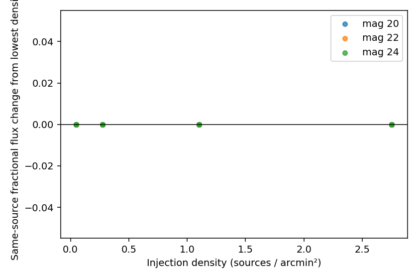

Scientific validation status
============================

This page is the concise scientific record for the current
``InjectionForcedPhotometryProcessor`` validation.  It distinguishes successful
software execution from evidence about photometric fidelity.  The methods and
column definitions are described in :doc:`scientific_validation`.

Status at 2026-09-25
--------------------

.. list-table::
   :header-rows: 1
   :widths: 20 20 12 15 25 8

   * - Validation
     - What it tests
     - Status
     - Data
     - Main result
     - Figure
   * - Real Rubin processor
     - Rubin image access and task execution
     - PASS in tested releases
     - DP0.2 and DP1 individual images
     - Real image loading, injection, forced measurement, and PROCESS complete
     - --
   * - Position and image modification
     - WCS placement and visible image change
     - INITIAL
     - Interior controlled sources
     - Sky-to-pixel positions are internally consistent and local image deltas are positive; injected centroids have not been fitted to sub-pixel precision
     - --
   * - PhotoCalib flux chain
     - Magnitude-to-instrumental-flux calibration
     - INITIAL
     - DP0.2 and DP1
     - ``magnitudeToInstFlux`` predictions and local image-difference sums agree in the tested high/intermediate-S/N regime; aperture sums remain diagnostics
     - --
   * - Before/after recovery
     - Separation of injected flux from the existing scene
     - PASS for method
     - DP0.2 and DP1
     - Recovery uses post-injection minus pre-injection forced flux; production ``meas_flux`` alone includes the pre-existing scene
     - --
   * - Photometric residuals
     - Flux recovery fidelity
     - INITIAL SMALL SAMPLE
     - 9 sources per release, magnitudes 20/22/24
     - Median fractional residual: 0.0085% (DP0.2), 0.0529% (DP1); position-to-position scatter remains visible
     - `DP0.2 residuals <_static/scientific_validation/2026-09-25/dp02/figures/density_fractional_residual.png>`__
   * - Pulls
     - Reported uncertainty behavior
     - INCONCLUSIVE
     - 9 sources per release
     - Pull standard deviation is 0.56 (DP0.2) and 0.45 (DP1); the before/after errors are correlated, so the current quadrature denominator is diagnostic, not yet calibrated
     - `DP1 pulls <_static/scientific_validation/2026-09-25/dp1/figures/density_pull.png>`__
   * - Repeatability
     - Deterministic injection
     - PASS for tested run
     - DP0.2 repeated with seed 12345
     - Two independently written Parquet products had identical SHA256 checksums
     - --
   * - Global injection density
     - Self-contamination from distant artificial sources
     - INITIAL
     - One DP0.2 and one DP1 image; 9--500 sources
     - No same-reference-source flux change or new flags/failures through about 2.8 sources/arcmin² with >=50-pixel artificial-source separation
     - `Same-source change <_static/scientific_validation/2026-09-25/dp1/figures/density_same_source_flux_change.png>`__
   * - Edges
     - Boundary behavior
     - NOT YET TESTED
     - --
     - --
     - --
   * - Masks and saturation
     - Masked-pixel and saturation behavior
     - NOT YET TESTED
     - --
     - --
     - --
   * - Local crowding
     - Deliberate injected-source blending
     - NOT YET TESTED
     - --
     - --
     - --
   * - Multi-image conditions
     - PSF/background/depth dependence
     - NOT YET TESTED
     - One image per release only
     - Current release comparison is not an image-condition survey
     - --

Initial isolated-source baseline
--------------------------------

Question
   Does a known isolated source produce approximately the expected calibrated
   signal and forced-photometry recovery on a real Rubin image?

Method
   Three interior positions per release were injected at magnitudes 20, 22,
   and 24.  Expected flux came from each image's ``PhotoCalib``.  Forced PSF
   flux was measured before and after injection, and the difference was
   compared with the expected instrumental flux.

Metric and result
   For DP0.2 (three sources), the fractional-residual mean, median, and sample
   standard deviation were -1.47%, -2.63%, and 3.06%; the pull mean and sample
   standard deviation were -0.85 and 1.01.  For DP1 they were -1.24%, -2.65%,
   and 2.89%, with pull mean -1.23 and standard deviation 1.77.  No native
   measurement flags were set.

Conclusion
   INITIAL SMALL-SAMPLE BASELINE.  The chain executes and has the correct sign
   and approximate scale.  Three sources do not establish bias or uncertainty
   calibration.

Expanded low-density baseline
-----------------------------

The density experiment provides a second, reproducible nine-position baseline
at its lowest level.  Each release has three sources at each of magnitudes 20,
22, and 24.

.. list-table::
   :header-rows: 1

   * - Release
     - N
     - Fractional residual mean
     - Median
     - Sample scatter
     - Pull mean
     - Pull scatter
   * - DP0.2
     - 9
     - 0.914%
     - 0.0085%
     - 4.39%
     - 0.063
     - 0.561
   * - DP1
     - 9
     - -0.667%
     - 0.0529%
     - 2.55%
     - 0.026
     - 0.451

The change relative to the earlier three-position sample shows why these
results must remain location- and image-specific.  The sub-unit pull scatter is
not an uncertainty-calibration pass: pre- and post-injection measurements share
the same underlying pixels and their errors are correlated, while the current
diagnostic adds their reported errors in quadrature.

Injection-density experiment
----------------------------

Question
   Does adding well-separated artificial sources elsewhere in an image alter
   recovered photometry for a fixed reference set?

Method
   One real image from each release was used.  Nine fixed reference sources
   (three each at magnitudes 20, 22, and 24) were retained in nested source sets
   containing 9, 50, 200, and 500 total sources.  Positions used seed 24680,
   injection noise used seed 12345, all positions were at least 100 pixels from
   the image boundary, and artificial sources were separated by at least 50
   pixels.  The image areas were approximately 180.64 arcmin² (DP0.2) and
   181.60 arcmin² (DP1).

Metric and result
   The tested densities were approximately 0.05, 0.28, 1.10, and 2.77
   sources/arcmin².  For both releases, each reference source's recovered flux
   was numerically unchanged from the lowest-density run at every tested
   density.  No injection failures or forced-measurement flags occurred.
   Per-level injection plus measurement runtime rose from about 0.4 seconds at
   9 sources to about 3.1 seconds at 500 sources.

Conclusion
   No global artificial-scene density effect was observed in these two images,
   this magnitude distribution, and this deliberately well-separated range.
   This does not set a safe production maximum and does not test local blending.

Durable evidence and reproduction
---------------------------------

Each release directory contains the 36-row Parquet product, a JSON summary,
run provenance, and four compact plots:

* :download:`DP0.2 Parquet <_static/scientific_validation/2026-09-25/dp02/density-validation.parquet>`
* :download:`DP0.2 provenance <_static/scientific_validation/2026-09-25/dp02/provenance.json>`
* :download:`DP1 Parquet <_static/scientific_validation/2026-09-25/dp1/density-validation.parquet>`
* :download:`DP1 provenance <_static/scientific_validation/2026-09-25/dp1/provenance.json>`

The campaign is regenerated in an initialized Rubin environment with:

.. code-block:: bash

   setup lsst_distrib
   export PYTHONPATH="$PWD:$PYTHONPATH"
   python -m ulens_lsst.validation_campaign \
       --release DP0.2 \
       --output docs/_static/scientific_validation/2026-09-25/dp02

Replace only the release and output directory for DP1.  Concrete Butler
repository, collection, image dataset type, and data-ID conventions come from
``get_data_release``; the validation command contains no release mapping.

Production schema recommendation for review
-------------------------------------------

.. list-table::
   :header-rows: 1
   :widths: 16 25 25 16 24

   * - Current column
     - Exact current meaning
     - Missing information
     - Cost
     - Recommendation
   * - ``ideal_mag``
     - Instantaneous model magnitude requested from injection
     - Explicit calibrated instrumental flux
     - One inexpensive PhotoCalib conversion and one float per row
     - Preserve ``expected_inst_flux``/``injected_flux`` before a large campaign
   * - ``injected_flux``
     - Currently populated with NaN by the PROCESS normalization layer
     - Actual PhotoCalib-derived injection flux
     - Negligible computation; about 8 uncompressed bytes per row as float64
     - This is the clearest backward-compatible field to populate, after schema review
   * - ``meas_flux``
     - Post-injection forced PSF instrumental flux; may include pre-existing scene flux
     - Pre-injection forced flux and covariance-aware difference uncertainty
     - Two more floats per row plus an additional forced measurement on the original image
     - Decide before RAC whether baseline-subtracted recovery must be possible from production output
   * - ``meas_flux_err``
     - Rubin uncertainty for the post-injection forced measurement
     - Covariance between before/after measurements
     - Covariance treatment requires scientific study, not just storage
     - Do not interpret the current before/after quadrature pull as calibrated
   * - status/flags
     - Compact processor statuses and joined Rubin flag names
     - Fully structured native flag columns
     - Several compressible boolean columns
     - Preserve the scientifically relevant native PSF-flux flags before RAC

No production schema was changed during this validation block.  The principal
decision for review is whether the RAC product must support baseline-subtracted
injected-flux recovery without rerunning forced measurement.  If yes, expected
instrumental flux is cheap to retain, but pre-injection photometry has a real
processing cost and should be benchmarked explicitly.

What remains unvalidated
------------------------

This record is not a completeness, detection-efficiency, DIA, or alert test.
The highest-value next validations are:

#. controlled close-neighbor separations to isolate local blending;
#. a small multi-image matrix spanning PSF/background/depth conditions;
#. a covariance-aware repeated-noise study before interpreting pull widths.
